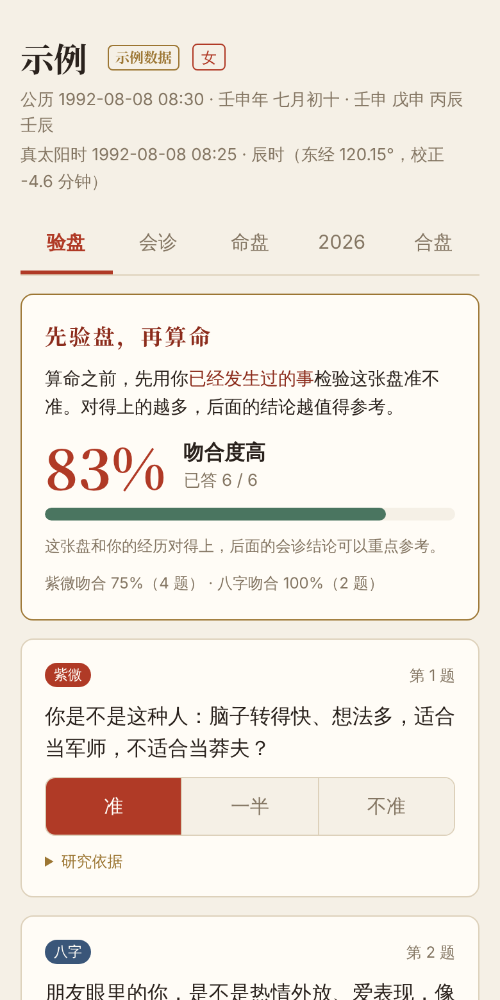
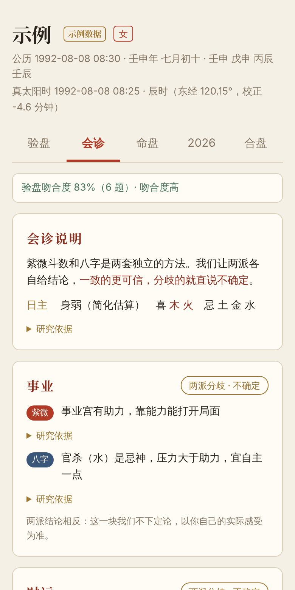
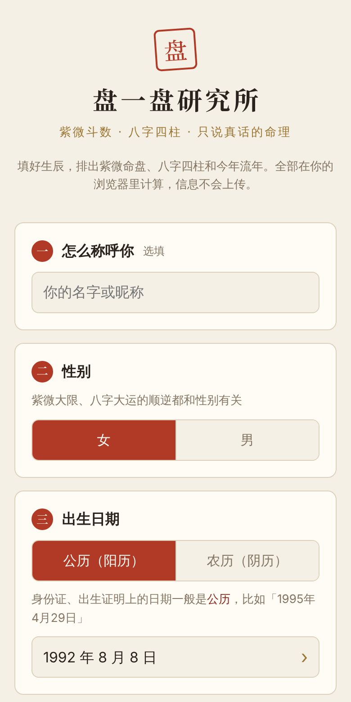
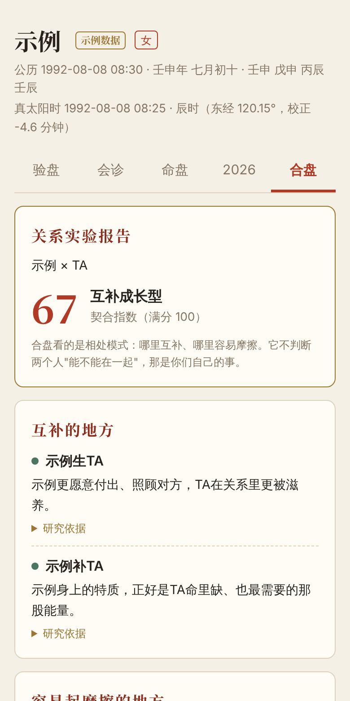

<div align="center">

# 盘一盘研究所

**紫微斗数 × 八字 · 先验盘，再算命**

一个"会被你检验"的算命工具：先用你经历过的事验证命盘准不准，对得上，再谈未来。

`紫微斗数` · `八字四柱` · `真太阳时排盘` · `验盘校准` · `双系统会诊` · `合盘` · `古籍有出处`

<br>

　　

</div>

---

## 我们和别的算命不一样的地方

> 市面上九成的算命是一门恐惧生意：把话说得神神叨叨、无所不知，用一句"你命里有一劫"套住你，再卖你一个转运的方法。
> **盘一盘研究所站在它的对立面。**

| | 别家 | 盘一盘研究所 |
|---|---|---|
| **准不准** | 排完盘直接下结论 | **先验盘**：用你过去的经历出题，算出这张盘的吻合度 |
| **怎么下结论** | 一套方法说了算 | **双系统会诊**：紫微、八字各说各的，一致的更可信，分歧的直说不确定 |
| **凭什么这么说** | 不告诉你 | **每条结论都能展开看研究依据**，古籍引文标了出处 |
| **算不了的事** | 硬编一个答案 | 直接说"这个算不了"，并说明为什么 |
| **说话方式** | "你命里有一劫" | 只讲倾向和课题，不吓人，不卖转运 |

---

## 三种用法

| | 适合谁 | 怎么用 |
|---|---|---|
| 📱 **手机网页版** | 想马上试试的人 | 下载 [`web/panyipan.html`](web/panyipan.html)，用手机或电脑浏览器打开 |
| 💬 **微信小程序版** | 想在微信里用 | 用微信开发者工具导入 [`miniprogram/`](miniprogram/) 文件夹 |
| 🤖 **Claude Code Skill** | 想要 AI 详细解读 | 安装 skill 后，在 Claude Code 里直接用中文问 |

网页版和小程序版**完全在本地计算**，不需要服务器，生辰信息不会上传。

---

## 网页版：完整体验

### 1. 开场：电子木鱼


排盘之前，先敲九下木鱼。

- 每敲一下飘出一句：功德 +1、杂念 −1、焦虑 −1、理性 +1……
- 敲满九下，木鱼裂开："**敲木鱼不改命，但能让你静下来，认真填生辰。**"
- 三种音色可选：清脆 / 厚实 / 寺院，木鱼声用模态合成实时生成
- 不想敲可以直接跳过

<br clear="right">

### 2. 填写生辰



五步引导，每一步都写了"怎么填"：

- **公历 / 农历**切换，农历支持闰月
- **出生时间**：知道几点几分，或者只知道时辰
- **出生地点**：省 → 市两级选择，覆盖全国 475 个地级市（直辖市到区）和港澳台，自动查经度
- 实时显示"钟表时间 → 真太阳时"，跨时辰或者离时辰交界不到 10 分钟会提醒
- 所有选择都用底部滚轮，不用原生控件

<br clear="right">

### 3. 验盘：先验盘，再算命


根据你的命盘，自动出 6 道关于"过去"的题，比如：

- 你是不是这种人：脑子转得快、想法多，适合当军师？（命宫主星）
- 2019 年前后，你的生活重心是不是有明显转变？（紫微大限交接）
- 2020 年，你的工作或学业是不是有过进展？（流年化禄入官禄宫）

每题选"准 / 一半 / 不准"，实时算出**吻合度**，并分紫微、八字两派统计。吻合度太低时，会建议你试试前一个或后一个时辰，因为最常见的原因是出生时间不准。

<br clear="right">

### 4. 会诊：两套方法，各说各的


事业、财运、感情、这十年、今年，五个主题。每个主题：

- **紫微**说一句，**八字**说一句
- 给出判断：两派一致 · 偏顺 / 两派一致 · 需留意 / 一派有信号 / **两派分歧 · 不确定**
- 两边结论相反时，直接写"这一块我们不下定论"

八字的日主强弱、喜忌也会写清楚是怎么估算出来的。

<br clear="right">

### 5. 命盘、今年、合盘



- **命盘**：八字四柱表（十神、藏干、纳音、十二长生）、五行、大运；紫微 4×4 命盘，点任意宫位看主星、辅星、星性
- **今年**：当前大限和今年流年的四化，分别落在哪个宫
- **合盘**：填上另一个人的生辰，生成"关系实验报告"，列出互补的地方、容易起摩擦的地方，每条附依据。**只看相处模式，不判断两个人能不能在一起。**

结果页底部可以一键复制整张盘的文字，粘贴给 Claude Code skill 做更细的解读。

<br clear="right">

---

## 排盘口径

各门派排法有分歧，我们统一按下面的口径，Python 脚本、网页版、小程序版完全一致（用同一命例交叉核对过）：

| 项 | 口径 |
|---|---|
| 子时 | 23:00 起即算次日（日柱、时柱都换） |
| 真太阳时 | 必须校正：经度时差 +（可选）均时差 |
| 年 / 月柱 | 立春换年，节气换月 |
| 大运起运 | 阳男阴女顺排、阴男阳女逆排；3 天折 1 岁、1 天折 4 个月、1 个时辰折 10 天 |
| 神煞 | 不排（子平正统做法） |
| 十二长生 | 保留，作为旺衰参考 |
| 八字解读顺序 | 先**调候**（穷通宝鉴）→ 再定**格局**（子平真诠）→ 最后看**旺衰喜忌**（滴天髓） |

---

## 古籍有出处

解读里引用的古书原话，都对照过原文电子本，并标了卷名或行号：

| 古籍 | 用在哪 | 参考文件 |
|---|---|---|
| 《紫微斗数全书》 | 紫微格局：君臣庆会、府相朝垣、七杀朝斗…… | [`quanshu_reference.md`](skills/mingli-master/references/quanshu_reference.md) |
| 《子平真诠》 | 八字定格局：月令取用、顺用逆用、成败救应 | [`bazi_reference.md`](skills/mingli-master/references/bazi_reference.md) |
| 《滴天髓》 | 八字看旺衰：日主强弱、五行流通、中和 | [`bazi_reference.md`](skills/mingli-master/references/bazi_reference.md) |
| 《穷通宝鉴》 | 八字调候：十天干 × 十二月，120 格原文 | [`qiongtong_tiaohou.md`](skills/mingli-master/references/qiongtong_tiaohou.md) |

古书里"克妻""夭折""贫贱"这类吓人的话，只用来辅助判断，不会原样转述给你。

---

## Claude Code Skill：AI 详细解读

想要比规则更细的解读，就用 skill。安装：

```bash
git clone https://github.com/ikkatrinazeng-sys/panyipan-lab.git
cp -r panyipan-lab/skills/mingli-master ~/.claude/skills/
python3 -m pip install iztro-py lunar_python --user
```

然后在 Claude Code 里直接说：

```
帮我看看命盘：1995年4月29日 上午10点，女，湖南郴州出生
帮我排个八字，看看用神是什么
我今年事业运怎么样？
我哪一年适合买房？
帮我和对象合个盘
```

skill 会排盘、解读，并生成一张书斋风格的可视化命盘（独立 HTML）。它能算的范围：

| 问题 | 方法 |
|---|---|
| 性格、事业、财运、感情 | 紫微斗数十二宫 + 四化 |
| 这十年、今年运势 | 紫微大限 / 流年四化（脚本计算） |
| 八字、用神 | 四柱 + 大运，调候 → 格局 → 旺衰 |
| 哪一年适合买房 | 田宅宫流年四化，只到年份 |
| 个人旺方 | 八宅命卦（会说明这是风水，不是紫微） |
| 合盘、择日 | 合盘看相处模式；择日只给到月份 |

**不算的**：生死寿数、具体哪个小区哪栋楼、彩票股票、别人的隐私。

<details>
<summary>skill 命盘预览</summary>
<br>

</details>

---

## 项目结构

```
├── web/                          # 手机网页版
│   ├── panyipan.html             #   打包好的成品，直接打开
│   ├── index.template.html       #   页面源码
│   ├── entry.js / build.sh       #   打包入口与脚本
│   └── README.md
├── miniprogram/                  # 微信小程序版（网页版与之共用 utils/）
│   ├── pages/                    #   输入页、结果页
│   ├── utils/
│   │   ├── chart.js              #   排盘核心：八字 + 紫微 + 流年
│   │   ├── insight.js            #   验盘出题、双系统会诊、合盘
│   │   ├── solar-time.js         #   真太阳时校正
│   │   └── lunar-picker.js       #   农历选择（含闰月）
│   └── libs/                     #   排盘引擎打包文件、全国省市经度表
└── skills/mingli-master/         # Claude Code Skill
    ├── SKILL.md                  #   触发条件、工作流程、禁忌
    ├── scripts/                  #   紫微 / 八字 / 流年 / 八宅排盘，命盘 HTML 生成
    └── references/               #   解读人格、星曜、四化、古籍要点、调候速查
```

修改网页版后重新打包：`cd web && npm i iztro esbuild && ./build.sh`

---

## 关于上线

- **网页版**可以放到任何静态网页托管上，用微信打开链接就能用。
- **微信小程序**对"算命、占卜"类内容审核很严，正式上线大概率被拒。自己预览、发体验版给朋友扫码不受影响。详见 [`miniprogram/README.md`](miniprogram/README.md)。

---

## 设计原则

- 不预言死亡
- 不制造恐惧
- 不替代你做人生决定
- 不说"你一定会"，只说"这个格局倾向于"

> 命盘是概率地图，不是判决书。它讲的是倾向，怎么走由你自己决定。

---

## 致谢

- 紫微排盘：[iztro](https://github.com/SylarLong/iztro) / [iztro-py](https://pypi.org/project/iztro-py/)
- 八字排盘：[lunar-typescript](https://github.com/6tail/lunar-typescript) / [lunar_python](https://pypi.org/project/lunar_python/)
- 《紫微斗数全书》整理本：[SylarLong/iztro-docs](https://github.com/SylarLong/iztro-docs)
- 《子平真诠》《滴天髓》《穷通宝鉴》电子本：[lineeks/ancient-text-library](https://github.com/lineeks/ancient-text-library)
- 行政区划：[modood/Administrative-divisions-of-China](https://github.com/modood/Administrative-divisions-of-China)；城市经度：[pyecharts](https://github.com/pyecharts/pyecharts)

## License

[MIT](LICENSE) © [katrinazeng](https://github.com/ikkatrinazeng-sys)

<div align="center">
<br>
<code>盘</code>　盘一盘研究所 · Panyipan Lab
</div>
